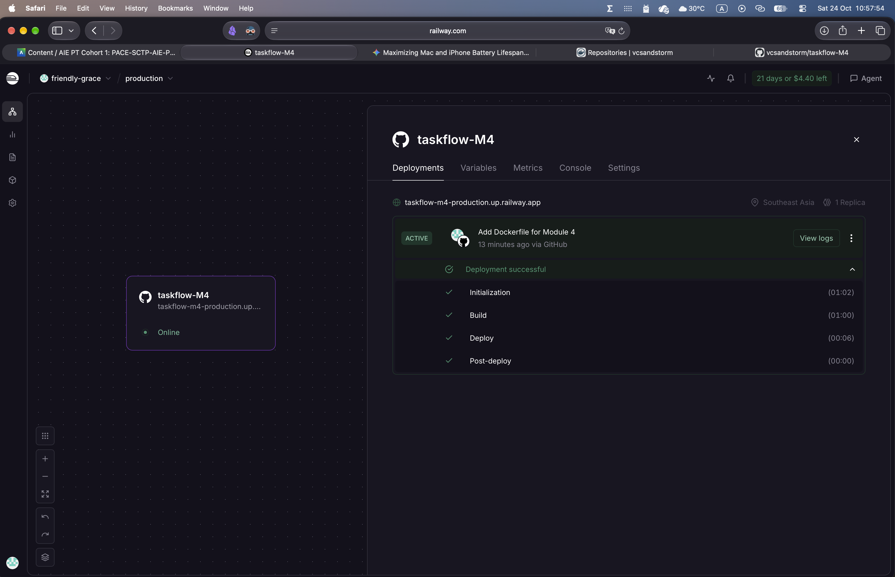
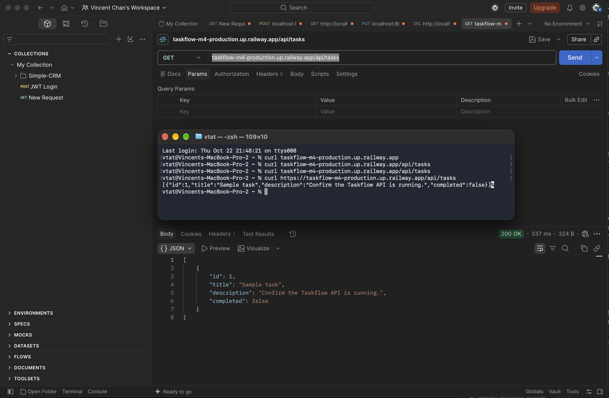
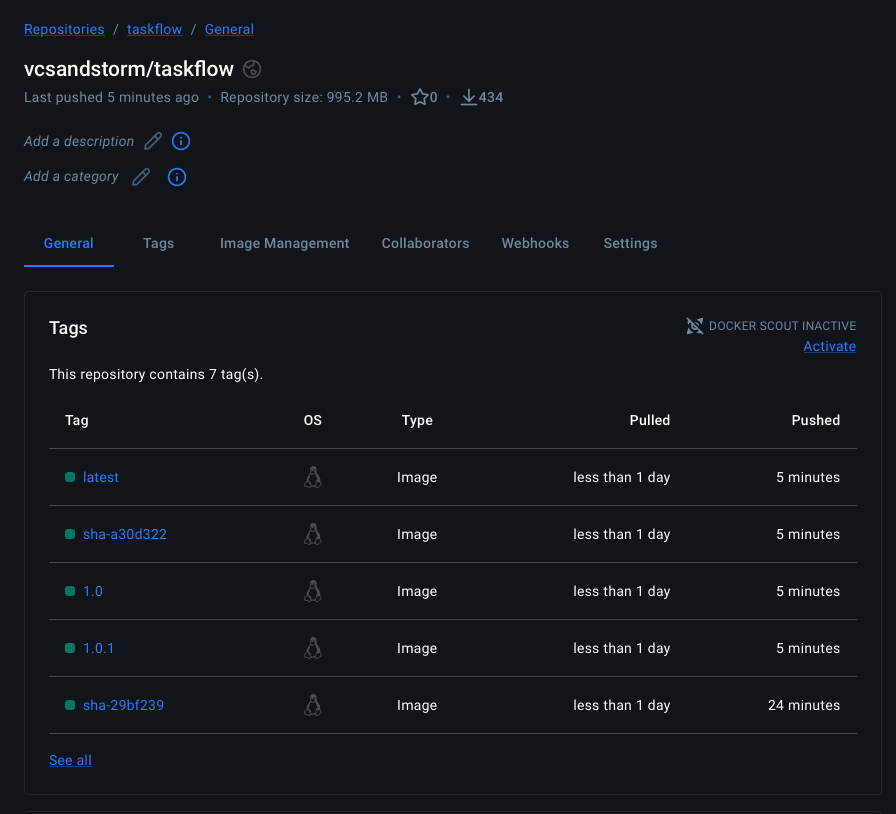

# TaskFlow API – Module 4: Dockerize & Deploy

TaskFlow API (from Module 3), containerized with Docker, deployed to Railway, with a GitHub Actions CI pipeline that publishes the image to Docker Hub.

- **GitHub repository:** https://github.com/vcsandstorm/taskflow-M4
- **Live application URL:** https://taskflow-m4-production.up.railway.app/api/tasks
- **Docker Hub image (stretch goal):** https://hub.docker.com/r/vcsandstorm/taskflow

## Tech stack

- Java 21
- Spring Boot 4.1.1 (Spring Web MVC)
- Spring AI (OpenAI-compatible client, pointed at OpenRouter)
- Maven
- Docker (multi-stage build)
- Railway (deployment)
- GitHub Actions (CI) + Docker Hub (image registry)
- JUnit 5 (unit tests)

## API endpoints

Base path: `/api/tasks`

| Method | Path | Description |
|--------|------|-------------|
| GET | `/api/tasks` | List all tasks |
| GET | `/api/tasks/{id}` | Get one task |
| POST | `/api/tasks` | Create a task |
| PUT | `/api/tasks/{id}` | Update a task |
| DELETE | `/api/tasks/{id}` | Delete a task |
| PUT | `/api/tasks/{id}/complete` | Mark a task as complete |
| GET | `/api/tasks/summary` | Task summary |

## Task 1: Dockerfile

The `Dockerfile` in the project root uses a multi-stage build:

1. **Build stage** (`maven:3.9-eclipse-temurin-21`) – copies the source and runs `mvn clean package -DskipTests` to build the JAR inside Docker. This means Railway can build the image straight from GitHub, even though the `target/` folder is not pushed.
2. **Runtime stage** (`eclipse-temurin:21-jre-alpine`) – copies only the built JAR into a small JRE image, exposes port 8080 and runs `java -jar app.jar`.

## Task 2: Build and test locally

```bash
docker build -t taskflow:latest .
docker run -p 8080:8080 -e OPENAI_API_KEY=<your-key> taskflow:latest
```

In a second terminal:

```bash
curl http://localhost:8080/api/tasks
```

Result: the API returned a JSON response with task data.

## Task 3: Deploy to Railway

1. Pushed the code (including the `Dockerfile`) to GitHub.
2. On Railway: **New Project → Deploy from GitHub repo →** selected this repository. Railway detected the `Dockerfile` and built the image.
3. Added the `OPENAI_API_KEY` environment variable in Railway (the app reads it from `application.properties`; the key is not committed to the repo).
4. **Settings → Networking → Generate Domain**, port set to `8080`.

## Task 4: Verify deployment

```bash
curl https://taskflow-m4-production.up.railway.app/api/tasks
```

Result: `200 OK` with this JSON response (tested with curl and Postman):

```json
[{"id":1,"title":"Sample task","description":"Confirm the Taskflow API is running.","completed":false}]
```

Railway shows the deployment **"Add Dockerfile for Module 4"** as **ACTIVE**, status **Online**, region Southeast Asia, 1 replica.

### Screenshots

**Railway dashboard – deployment active**



**Live application URL working**



## Errors and failures

All four baseline tasks and the Option 1 stretch goal were completed. Below are the errors I hit along the way and how I fixed them.

### 1. `curl` returned nothing without `https://`

- **What happened:** `curl taskflow-m4-production.up.railway.app/api/tasks` printed nothing (no error, no JSON).
- **Fix:** added `https://` to the URL, which returned the JSON response.
- **Lesson:** without a scheme, curl uses plain HTTP, and the Railway domain did not return the API response over HTTP. Always use the full `https://` URL.

### 2. `git push` failed: branch name typo

- **Error:**
  ```
  error: src refspec stretch/ci-pipeline does not match any
  error: failed to push some refs to 'https://github.com/vcsandstorm/taskflow-M4'
  ```
- **Cause:** the branch had been created as `stretch/ci-pipline` (missing an "e"), so Git could not find a branch called `stretch/ci-pipeline`.
- **Fix:** checked the name with `git branch`, renamed it with `git branch -m stretch/ci-pipeline`, then pushed again.
- **Lesson:** run `git branch` to confirm the exact branch name before pushing.

### 3. Workflow run failed: "No jobs were run"

- **What happened:** after the first push of the branch, GitHub Actions reported a failed run for `.github/workflows/ci.yml` with the message **"No jobs were run"**.
- **Cause:** `ci.yml` had been committed as an **empty file (0 bytes)** – the content was not saved before `git add`.
- **Fix:** pasted the workflow content, saved the file, confirmed it was no longer empty with `wc -c .github/workflows/ci.yml`, then committed and pushed again.
- **Lesson:** save files before committing, and check `git status` / file size when something looks wrong.

### 4. Docker build failed: invalid tag `/taskflow:latest`

- **Error** (in the "Build and push Docker image" step):
  ```
  ERROR: failed to build: invalid tag "/taskflow:latest": invalid reference format
  ```
- **Cause:** the `DOCKERHUB_USERNAME` GitHub secret had not been added yet. GitHub replaced the missing secret with an empty string, so the image tag became `/taskflow:latest` instead of `vcsandstorm/taskflow:latest`. The workflow uses the username in the image tag even on Pull Requests (where it does not push), so the secret is needed for every run.
- **Fix:** created a Docker Hub personal access token (Read & Write), added `DOCKERHUB_USERNAME` and `DOCKERHUB_TOKEN` under **Settings → Secrets and variables → Actions**, then used **Re-run jobs → Re-run failed jobs**. The check passed.
- **Lesson:** a missing secret does not raise its own error – it silently becomes empty, and the failure shows up later in a confusing place.

### Note: the project had no tests at first

The `pom.xml` already included the test libraries, but `src/test` was empty, so a "test" step would have passed without testing anything. I added `TaskServiceTest` (8 unit tests) so the CI test step does real work.

## Stretch goal – Option 1: CI pipeline (GitHub Actions → Docker Hub)

I added a GitHub Actions workflow at [`.github/workflows/ci.yml`](.github/workflows/ci.yml).

**What it does**

| Trigger | Steps |
|---|---|
| Pull Request into `main` | Check out code → set up Java 21 → `./mvnw -B clean verify` (build + unit tests) → build Docker image (**not pushed**) |
| Push to `main` (including merges) | Same as above, then log in to Docker Hub and **push** the image |

Images are pushed with two tags:
- `vcsandstorm/taskflow:latest`
- `vcsandstorm/taskflow:<commit SHA>` – so every build can be traced back to its exact commit

**Two pipelines side by side**

```
push to main ─┬─► GitHub Actions ─► Docker Hub   (CI: build, test, publish image)
              └─► Railway        ─► live app    (deployment: Railway builds from the Dockerfile)
```

**Secrets:** Docker Hub credentials are stored as GitHub Actions secrets (`DOCKERHUB_USERNAME`, `DOCKERHUB_TOKEN`) and are never in the code.

**Unit tests:** [`src/test/java/sg/edu/ntu/taskflow_api/service/TaskServiceTest.java`](src/test/java/sg/edu/ntu/taskflow_api/service/TaskServiceTest.java) – 8 tests covering create, find all, find by id (incl. missing id), update, delete, mark complete (incl. missing id), and the empty-list AI summary. They use the in-memory repository and make no AI calls, so CI does not need an `OPENAI_API_KEY`.

**Workflow:** the work was done on branch `stretch/ci-pipeline` and merged into `main` through Pull Request #1 after the CI check passed.

**Links**

- Successful pipeline run: https://github.com/vcsandstorm/taskflow-M4/actions/runs/40264854693
- Docker Hub image: https://hub.docker.com/r/vcsandstorm/taskflow
- All workflow runs: https://github.com/vcsandstorm/taskflow-M4/actions/workflows/ci.yml

<!-- Optional screenshots:


-->
